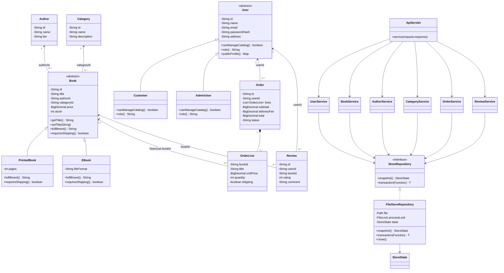

# Class diagram

The companion `class-diagram.svg` is a standalone diagram for the report. The Mermaid source below is also editable and renders on GitHub.

Relationships use IDs rather than serialized object graphs. Historical order lines keep the purchased title and price, so later catalog changes do not rewrite old receipts. `0..1` permits a completed/cancelled order's original book to be removed. The diagram omits routine accessors for readability; every persisted domain field is private with public accessors.
