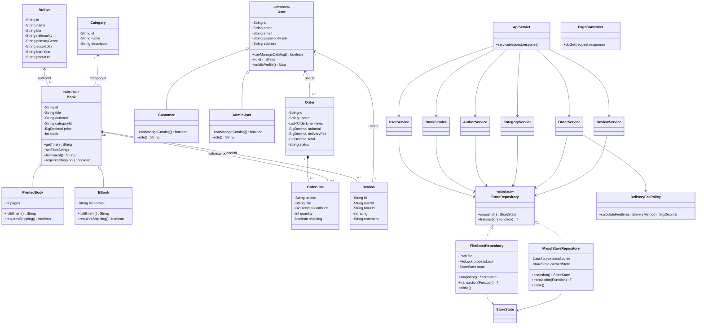

# Class diagram (UML 2.5)

Print-ready A3 Landscape vector diagrams and documentation assets:
- **A3 Print PDF**: [`Book-and-Bloom-SE1020-Class-Diagram-A3.pdf`](Book-and-Bloom-SE1020-Class-Diagram-A3.pdf) (High-resolution ISO A3 420mm × 297mm vector PDF for viva presentation)
- **A3 High-Res PNG**: [`Book-and-Bloom-SE1020-Class-Diagram-A3.png`](Book-and-Bloom-SE1020-Class-Diagram-A3.png)
- **Vector SVG**: [`class-diagram-A3.svg`](class-diagram-A3.svg)

The editable Mermaid source below renders directly in GitHub previews and markdown viewers.

Relationships use IDs rather than serialized object graphs. Historical order lines keep the purchased title and price, so later catalog changes do not rewrite old receipts. `0..1` permits a completed/cancelled order's original book to be removed. The diagram omits routine accessors for readability; every persisted domain field is private with public accessors.
