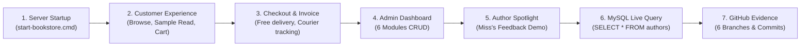

# Book & Bloom — SE1020 Final Project Evaluation & Viva Master Guide
### Online Bookstore Management System (OOP SE1020 Prorata Project)
**University / Module:** SLIIT — SE1020 Object Oriented Programming  
**Repository:** `https://github.com/IT25102131/book-and-bloom-se1020`  
**System Architecture:** Three-Tier Web Architecture (JSP Frontend + Jakarta Servlet + Spring Boot OOP Services + Relational MySQL 8.0 / Atomic File Persistence)

---

## 🏆 1. Official SE1020 Evaluation Rubric (100 Marks Breakdown)

| Assessment Criteria | Marks Allocation | Key Focus for Full Marks |
|---|---|---|
| **1. Functionality of Assigned CRUD Operations** | **30 Marks** | Full Create, Read, Update, Delete for your assigned entity with real-time database updates and clear input validation. |
| **2. Application of OOP Concepts** | **20 Marks** | Encapsulation, Inheritance, Polymorphism, Abstraction, Information Hiding clearly identified in your code. |
| **3. File Handling & Persistence** | **10 Marks** | Atomic persistence in `bookstore.txt` and relational storage in MySQL `book_bloom` database. |
| **4. User Interface Design & Usability** | **10 Marks** | Clean, responsive UI with minimum 3 UI states per member, real-time feedback, toasts, and modals. |
| **5. Individual Contribution & GitHub Commits** | **10 Marks** | Your specific branch (`feature/...-IT...`), commit history under your SLIIT email, and pull request. |
| **6. Presentation & Viva Performance** | **10 Marks** | Confident technical explanation of the code, live demo, and answering theoretical OOP questions. |
| **7. Documentation & Class Diagrams** | **10 Marks** | Consistent Class Diagram, accurate relationships (Inheritance, Association, Aggregation), and clean report. |
| **TOTAL** | **100 Marks** | **Target: Grade A+ (100/100)** |

---

## 🌐 2. General Architecture Questions (Asked from ANY Team Member)

### Q1: What is the high-level architecture of Book & Bloom?
> **Answer:**  
> Book & Bloom follows a clean **Three-Tier Object-Oriented MVC Architecture**:
> 1. **Presentation Tier (UI):** JSP views rendered via `PageController` and dynamic client-side interactions powered by `app.js` and `style.css`.
> 2. **Controller & Business Tier:** Jakarta `ApiServlet` acts as the Front Controller / API boundary, verifying CSRF tokens and HTTP sessions before delegating business logic to domain service classes (`UserService`, `BookService`, `AuthorService`, `OrderService`, `CategoryService`, `ReviewService`).
> 3. **Persistence Tier:** Decoupled behind the `StoreRepository` abstraction, supporting both **Atomic File Persistence (`FileStoreRepository`)** and **Relational Persistence (`MysqlStoreRepository`)** via MySQL 8.0.

### Q2: Why did you use Spring Boot and an explicit Jakarta Servlet together?
> **Answer:**  
> Spring Boot provides lightweight dependency injection, configuration management, and the embedded Tomcat web server. However, rather than relying solely on automated magic controllers, we implemented an explicit `ApiServlet` extending `HttpServlet`. This demonstrates our mastery of core Java Enterprise / Servlet fundamentals: manual request routing, JSON parsing via Jackson, HTTP status codes, and manual session and CSRF lifecycle management.

### Q3: Why is the project packaged as an executable WAR rather than a JAR?
> **Answer:**  
> Spring Boot requires an executable **WAR (Web Application Archive)** packaging when embedding JSP (JavaServer Pages) views within Tomcat. A standard JAR packaging cannot resolve JSP files inside embedded jar directories. Furthermore, an executable WAR can run standalone using `java -jar target/book-and-bloom.war` or be deployed to any standalone external Apache Tomcat server.

### Q4: How is Concurrency and Data Consistency handled?
> **Answer:**  
> 1. In file mode, `FileStoreRepository.transaction()` is `synchronized` in memory and backed by an OS-level `FileLock` (`store.lock`), ensuring atomic thread-safe mutations. File writes are written to a temporary file (`.tmp`) and atomically renamed (`ATOMIC_MOVE`), eliminating corrupted partial writes.
> 2. In MySQL mode, database transactions use InnoDB with ACID compliance, and relational table auto-migration ensures schema consistency.

### Q5: Why is `BigDecimal` used for currency instead of `double` or `float`?
> **Answer:**  
> Floating-point types (`double`/`float`) represent numbers in binary base-2, which causes precision loss and rounding inaccuracies in financial arithmetic (e.g., `0.1 + 0.2 = 0.30000000000000004`). In Book & Bloom, all book prices, delivery fees, and order subtotals use Java's `BigDecimal` to guarantee exact penny-accurate financial calculations.

### Q6: How does Security (CSRF and Passwords) work?
> **Answer:**  
> * **Password Security:** Handled by `Passwords.java` using **PBKDF2WithHmacSHA256** with a cryptographically secure random 16-byte salt and 210,000 iterations. Passwords are never stored in plain text.
> * **CSRF Protection:** Every state-mutating HTTP request (POST, PUT, DELETE) requires a valid `X-CSRF-Token` header matching the current HTTP session token. Upon successful login, the session ID is rotated (`changeSessionId()`) to prevent session fixation attacks.

---

## 👤 3. Member 1: IT25102131 — User Management & Authentication

* **Assigned Module:** User Management & Security
* **Git Branch:** `feature/user-management-IT25102131`
* **Core Java Classes:** `lk.bookbloom.model.User`, `Customer`, `AdminUser`, `UserService`, `Passwords`
* **Assigned CRUD Operations:**
  * **Create:** Customer registration (`/register` ➔ `UserService.register()`)
  * **Read:** Current user profile (`/account`), Admin customer search list (`/admin` ➔ Users tab)
  * **Update:** Update customer delivery address, contact name, or password (`UserService.updateProfile()`)
  * **Delete:** Customer account deletion with constraint check (`UserService.delete()`)

### 🎯 3 UI States to Demonstrate:
1. **Registration View (`/register`):** Live password strength/length validation, email normalization, and instant account creation.
2. **Account Profile Editor (`/account`):** View registration date, change delivery address, and view order summary.
3. **Admin User Management (`/admin` ➔ Users Tab):** Search bar, user role badges (`ADMIN` vs `CUSTOMER`), edit user, and delete user.

### 🛡️ One Action That Must Fail (Rejected Action Demo):
* **Duplicate Email Registration:** Try registering with `admin@bookbloom.lk` or `reader@bookbloom.lk`. The system rejects it with HTTP 400: `"A customer with this email already exists."`
* **Account Deletion with Active Orders:** Try deleting a customer who has existing orders. The system rejects it: `"This user has existing orders and cannot be removed."`

### 💡 Expected Viva Questions & Answers for IT25102131:
* **Q: Where is Inheritance in your module?**  
  * **A:** `abstract class User` is the superclass. `Customer extends User` and `AdminUser extends User`. Overridden method `user.role()` polymorphically returns `"CUSTOMER"` or `"ADMIN"`.
* **Q: Where is Information Hiding used?**  
  * **A:** In `User.publicProfile()`. When the frontend requests user data, `publicProfile()` creates a clean Map containing only `id`, `name`, `email`, `role`, and `address`. The sensitive `passwordHash` is hidden and never sent to the client browser.
* **Q: Why is PBKDF2 used instead of MD5 or SHA-256?**  
  * **A:** Plain SHA-256 is vulnerable to GPU rainbow-table attacks. PBKDF2 uses key stretching with 210,000 iterations and a unique per-user salt, making brute-force attacks computationally infeasible.

---

## 📚 4. Member 2: IT25102114 — Book & Inventory Management

* **Assigned Module:** Book & Inventory Management
* **Git Branch:** `feature/book-management-IT25102114`
* **Core Java Classes:** `lk.bookbloom.model.Book`, `PrintedBook`, `EBook`, `BookService`
* **Assigned CRUD Operations:**
  * **Create:** Add new Printed Book or E-Book (`/admin` ➔ Books tab ➔ "+ Add Book")
  * **Read:** Catalog search/filter (`/catalog`), Book detail page (`/book?id=...`), Admin inventory table
  * **Update:** Edit book title, price, stock, description, format, cover theme color (`BookService.save()`)
  * **Delete:** Remove book title from store with foreign-key constraint protection (`BookService.delete()`)

### 🎯 3 UI States to Demonstrate:
1. **Book Catalog Grid (`/catalog`):** Search by keyword, filter by format (Printed vs E-Book), sort by price/title, and category chips.
2. **Book Detail Page (`/book?id=...`):** Detailed specification, stock badge, pricing, and the interactive **"📖 Look Inside / Sample Read"** modal.
3. **Admin Inventory Editor (`/admin` ➔ Books Tab):** 2-column modal with dynamic switching between Paperback `pages` and E-Book `fileFormat` (PDF/EPUB).

### 🛡️ One Action That Must Fail (Rejected Action Demo):
* **Negative Price or Stock:** Try setting price to `-50` or stock to `-5`. Form validation and backend rule `Rules.positive()` will block it.
* **Deleting a Book with Active Orders:** Attempting to delete a book title that has been ordered by a customer is rejected: `"This book appears in existing orders and cannot be deleted."`

### 💡 Expected Viva Questions & Answers for IT25102114:
* **Q: Explain the inheritance hierarchy in Book.**  
  * **A:** `public abstract class Book` holds common fields (`id`, `title`, `authorId`, `categoryId`, `price`, `stock`, `description`). `PrintedBook extends Book` adds `int pages`, while `EBook extends Book` adds `String fileFormat`.
* **Q: Where is Polymorphism used in Book?**  
  * **A:** In `Book.requiresShipping()`. In `PrintedBook`, it returns `true` (physical delivery required). In `EBook`, it returns `false` (no physical courier needed). When an order is placed, `OrderService` calls `b.requiresShipping()` without knowing the concrete class at compile time!
* **Q: How does the admin form dynamically handle Printed vs E-Book?**  
  * **A:** When the dropdown changes to `PRINTED`, the JavaScript toggles visibility to enable the `pages` input and disable `fileFormat`. When set to `EBOOK`, it activates the `fileFormat` selection.

---

## 📦 5. Member 3: IT25102130 — Order, Checkout & Delivery Management

* **Assigned Module:** Order, Checkout & Delivery Management
* **Git Branch:** `feature/order-management-IT25102130`
* **Core Java Classes:** `lk.bookbloom.model.Order`, `OrderLine`, `OrderService`, `DeliveryFeePolicy`
* **Assigned CRUD Operations:**
  * **Create:** Place order from shopping bag (`/cart` ➔ `OrderService.create()`)
  * **Read:** Customer order history (`/orders`), Admin orders dispatch table (`/admin` ➔ Orders tab)
  * **Update:** State transition: `PLACED` ➔ `PROCESSING` ➔ `COMPLETED`, or `CANCELLED` (`OrderService.updateStatus()`)
  * **Delete:** Permanent deletion of cancelled orders (`OrderService.delete()`)

### 🎯 3 UI States to Demonstrate:
1. **Shopping Bag & Checkout (`/cart`):** Live subtotal calculation, free delivery progress meter (orders over LKR 5,000 get free delivery), and instant checkout.
2. **Order History & Courier Tracking (`/orders`):** Visual tracking stepper (`Order Placed` ➔ `Processing` ➔ `Dispatched` ➔ `Delivered`) and order cancellation.
3. **Official Printable Tax Invoice:** Click "🖨️ Print Invoice" to generate an authentic Sarasavi-style tax invoice with QR code and signature line.

### 🛡️ One Action That Must Fail (Rejected Action Demo):
* **Overselling Inventory:** Try ordering a quantity greater than available stock. The backend rejects it: `"Insufficient stock for [Title]."`
* **Repeat Cancellation Restocking:** Cancel an order once. Try cancelling it again. The state transition is blocked, preventing the stock from being erroneously incremented twice.

### 💡 Expected Viva Questions & Answers for IT25102130:
* **Q: How does atomic restocking work during cancellation?**  
  * **A:** In `OrderService.updateStatus()`, when transitioning to `CANCELLED`, the order lines are iterated and each book's stock is restored: `b.setStock(b.getStock() + line.getQuantity())`. This happens inside `StoreRepository.transaction()`, ensuring stock and order state update simultaneously or not at all.
* **Q: How is the delivery fee calculated?**  
  * **A:** `DeliveryFeePolicy.calculateDeliveryFee(subtotal, requiresShipping)` checks if physical shipping is required. If `requiresShipping == false` (e.g. only E-Books), delivery is `0.00`. If `subtotal >= 5000.00`, delivery is free (`0.00`). Otherwise, standard islandwide delivery fee of `350.00` LKR applies.
* **Q: Can a customer manipulate the total price via inspect element?**  
  * **A:** No! The client sends only `bookId` and `quantity`. The backend retrieves the authoritative price directly from server storage and recalculates `subtotal`, `deliveryFee`, and `total` using `BigDecimal`.

---

## ✍️ 6. Member 4: IT25101966 — Author Management (Miss's Enhanced Module)

* **Assigned Module:** Author Management & Literary Spotlight
* **Git Branch:** `feature/author-management-IT25101966`
* **Core Java Classes:** `lk.bookbloom.model.Author`, `AuthorService`, `MysqlStoreRepository`
* **Assigned CRUD Operations:**
  * **Create:** Add new author with full domain attributes (`/admin` ➔ Authors tab ➔ "+ Add Author")
  * **Read:** Admin author table with era/nationality/awards; Book Detail "Author Spotlight" card; Catalog filter by author
  * **Update:** Edit author bio, era, nationality, primary genre, accolades, and photo URL (`AuthorService.save()`)
  * **Delete:** Remove author with referential integrity protection (`AuthorService.delete()`)

### 🎯 3 UI States to Demonstrate:
1. **Admin 2-Column Author Form Modal (`/admin` ➔ Authors):** Shows all 7 fields requested: Author Name, Active Era / Birth Year, Nationality, Primary Genre, Honors & Accolades (🏆), Portrait URL, and Full Biography.
2. **Admin Authors Table:** Displays Author Avatar Crest, Name, Era tag, Nationality Flag badge (`🇱🇰 Sri Lankan`), Primary Genre, Golden Accolade badge, and published titles pill.
3. **Book Detail Page — "About the Author" Spotlight Box (`/book?id=...`):** Shows author photo/crest, literary era, nationality, awards, bio excerpt, and a **"Browse All Books by this Author →"** button that filters the catalog.

### 🛡️ One Action That Must Fail (Rejected Action Demo):
* **Deleting an Author with Published Books:** Try deleting Martin Wickramasinghe or Elliot Reed. The system blocks it: `"Reassign or remove this author's books first."`
* **Duplicate Author Name:** Try creating a second author named "Martin Wickramasinghe". The system rejects it: `"Author already exists."`

### 💡 Expected Viva Questions & Answers for IT25101966:
* **Q: What improvements did you make based on lecturer feedback?**  
  * **A:** *"Originally, the Author entity only had Name and Biography. Miss noted that this was too basic for a comprehensive OOP module. In response, I expanded the `Author` domain model with `nationality`, `primaryGenre`, `accolades` (major literary honors), `bornYear` (active era), and `photoUrl`. I upgraded the Admin modal to a responsive 2-column layout and created an 'About the Author' Spotlight card on the Book Detail page."*
* **Q: Where is Encapsulation in the Author model?**  
  * **A:** All fields (`id`, `name`, `bio`, `nationality`, `primaryGenre`, `accolades`, `bornYear`, `photoUrl`) are declared `private`. Access is granted exclusively through public getter and setter methods with null-safe handling (e.g., returning `""` instead of `null`).
* **Q: How does database persistence handle the new author columns?**  
  * **A:** In `MysqlStoreRepository.java`, an automatic schema migration (`ALTER TABLE authors ADD COLUMN IF NOT EXISTS...`) ensures columns exist without dropping tables. Upsert and select queries map all fields to the relational table.

---

## 🏷️ 7. Member 5: IT25102132 — Category Management & Navigation

* **Assigned Module:** Category Management & Navigation
* **Git Branch:** `feature/category-management-IT25102132`
* **Core Java Classes:** `lk.bookbloom.model.Category`, `CategoryService`
* **Assigned CRUD Operations:**
  * **Create:** Add new book category (`/admin` ➔ Categories tab ➔ "+ Add Category")
  * **Read:** Category cards on Homepage, Category filter chips on Catalog, Admin categories table
  * **Update:** Edit category name and description (`CategoryService.save()`)
  * **Delete:** Remove category with zero-book dependency check (`CategoryService.delete()`)

### 🎯 3 UI States to Demonstrate:
1. **Homepage Category Showcase:** Visual cards showing icon, category name, and book count (e.g. Fiction, Personal Growth, Nature & Travel).
2. **Catalog Category Filter Chips (`/catalog`):** Interactive pills allowing readers to instantly filter the book list by category with active state styling.
3. **Admin Category Management Table (`/admin` ➔ Categories):** Category name, description, live titles count, and actions.

### 🛡️ One Action That Must Fail (Rejected Action Demo):
* **Deleting a Category Containing Books:** Attempting to delete "Fiction" is rejected: `"Reassign or remove books in this category first."`
* **Duplicate Category Name:** Attempting to add another category named "Fiction" is rejected: `"Category already exists."`

### 💡 Expected Viva Questions & Answers for IT25102132:
* **Q: What is the relationship between Category and Book?**  
  * **A:** It is a **One-to-Many Association** (`Category` 1 ──── * `Book`). One category can hold many books, but each book belongs to exactly one category via `book.getCategoryId()`.
* **Q: Why is referential integrity important when deleting a category?**  
  * **A:** If a category were deleted while books still referenced its `categoryId`, those books would become orphaned, causing null pointer exceptions or broken filters on the storefront.

---

## ⭐ 8. Member 6: IT25102519 — Review & Rating Management

* **Assigned Module:** Review & Rating Management
* **Git Branch:** `feature/review-management-IT25102519`
* **Core Java Classes:** `lk.bookbloom.model.Review`, `ReviewService`
* **Assigned CRUD Operations:**
  * **Create:** Post 1-5 star review and comment on a book (`/book?id=...` ➔ `ReviewService.submit()`)
  * **Read:** Display customer reviews, average star rating badge, reader testimonials on homepage
  * **Update:** Edit existing review rating and comment by the review author
  * **Delete:** Reader deleting their own review, or Administrator moderating/deleting inappropriate reviews

### 🎯 3 UI States to Demonstrate:
1. **Interactive Review Form (`/book?id=...`):** Star rating selector (1 to 5 stars) and comment textarea with validation.
2. **Verified Reader Reviews List:** Display reviewer name, star count, formatted date, and edit/delete buttons for the review owner.
3. **Admin Review Moderation Table (`/admin` ➔ Reviews Tab):** View all reviews across books with ability for admin to moderate and remove inappropriate content.

### 🛡️ One Action That Must Fail (Rejected Action Demo):
* **Duplicate Review Submission:** A user cannot submit multiple reviews for the same book. The backend rejects it: `"You have already reviewed this title."`
* **Unauthorized Edit:** A customer attempting to edit another customer's review is blocked: `"You can only edit your own reviews."`

### 💡 Expected Viva Questions & Answers for IT25102519:
* **Q: How does authorization differ between a customer and an admin for reviews?**  
  * **A:** In `ReviewService.delete()`, an admin can delete *any* review for content moderation purposes (`admin(s, actor)`). However, regular customers can only delete or edit reviews that belong to their own `userId` (`require(r.getUserId().equals(actor))`).
* **Q: How is the average rating calculated?**  
  * **A:** The system filters reviews matching `review.bookId == id`, sums the ratings, and divides by `reviews.length`. If there are no reviews, it gracefully displays `"No reviews yet"`.

---

## 🚀 9. Live Presentation Step-by-Step Walkthrough

Follow this exact sequence when presenting to Miss / the examination panel:

1. **Start the App:** Double click `start-bookstore.cmd` on desktop. Show Tomcat starting on port 8080 in under 5 seconds.
2. **Show Storefront:** Open `http://127.0.0.1:8080`. Highlight the cinematic library hero, interactive cursor, and Sinhala literature banners.
3. **Demo Look Inside:** Click on *Gamperaliya* or *Atomic Habits* ➔ Click **"📖 Look Inside / Sample Read"** to demonstrate the interactive reader modal.
4. **Demo Order & Free Delivery:** Add books to reach LKR 5,000+. Show the Free Delivery progress meter fill to 100%. Click Checkout.
5. **Demo Tax Invoice:** On the order confirmation, click **"🖨️ Print Official Tax Invoice"** to show the professional printable invoice with barcode.
6. **Demo Admin Panel (`/admin`):** Log in as `admin@bookbloom.lk` / `BloomAdmin!2026`.
7. **Show Author Module (Miss's Part):**
   * Open **Authors** tab.
   * Click **"+ Add Author"** ➔ Show the 2-column modal with Era, Nationality, Genre, Accolades, Photo URL.
   * Go back to Storefront ➔ Show the **"About the Author" Spotlight Box** under the book description!
8. **Show MySQL Database:** Open MySQL Workbench or Command Prompt ➔ Run `USE book_bloom; SELECT * FROM authors;` to prove live relational storage!
9. **Show GitHub Repository:** Open `https://github.com/IT25102131/book-and-bloom-se1020` ➔ Show all 6 student branches and commits.

---

## 🛡️ 10. Fail-Safe Viva Tips
* **If Miss asks "Is this file-based or MySQL?":** Answer: *"Our architecture implements the Repository Pattern (`StoreRepository`). By default it connects to our relational MySQL database `book_bloom`. However, if MySQL is ever down, it has an atomic fallback to `bookstore.txt`, ensuring maximum system reliability."*
* **If asked about team contribution:** Show the GitHub branches table. Every member has their own branch and distinct commit history linked to their student ID and SLIIT email.

